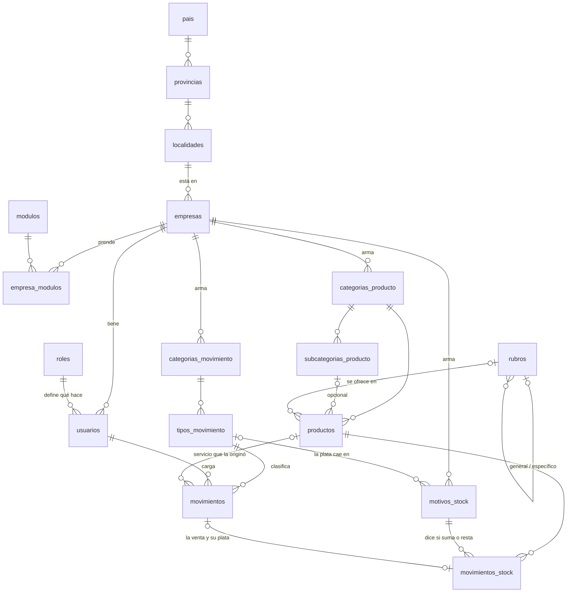

# Modelo de datos · CooperApp

Qué guarda cada tabla, cómo se relacionan y qué reglas hay que respetar para no
romper los números. Está escrito para quien retome el proyecto sin haber estado
cuando se diseñó.

- **El esquema de verdad es [`database.sql`](../database.sql).** Adentro tiene
  comentarios largos que explican el porqué de cada decisión. Este documento es el
  mapa: si en algo no coinciden, manda el `.sql`, y este documento hay que
  corregirlo.
- Base **MariaDB/MySQL**, llamada `cooperApp`, en `utf8mb4` (acentos, ñ, `€`).
- **19 tablas** (al 14/11/2026).

---

## El mapa



GitHub dibuja este diagrama solo. En otro visor se ve como texto: se lee igual,
cada línea es "tabla — relación — tabla".

Las tablas se agrupan así:

| Grupo | Tablas | Quién las carga |
|---|---|---|
| **Plataforma** | `empresas`, `usuarios`, `roles` | El registro, el superadmin y el admin de cada empresa |
| **Listas fijas** | `pais`, `provincias`, `localidades`, `rubros`, `modulos` | El sistema, en `database.sql`. **No se editan desde la app** |
| **Módulos por empresa** | `empresa_modulos` | El admin de cada empresa |
| **Plata** | `categorias_movimiento`, `tipos_movimiento`, `movimientos` | Cada empresa |
| **Catálogo** | `categorias_producto`, `subcategorias_producto`, `productos` | Cada empresa (productos **y** servicios) |
| **Stock** | `motivos_stock`, `movimientos_stock` | Cada empresa |
| **Sin uso** | `permisos`, `rol_permisos` | Nadie (ver al final) |

---

## Las reglas que valen para todas las tablas

**1. Casi todo es de una empresa.** Toda tabla con datos del día a día tiene
`id_empresa`, y **toda consulta tiene que filtrar por la empresa de la sesión**
(`req.session.user.empresa.id`), nunca por un id que mande la pantalla. Es lo que
impide que una empresa vea o toque datos de otra. Cuando una tabla cuelga de otra
(un tipo cuelga de una categoría), la pertenencia se controla subiendo hasta la que
tiene `id_empresa`.

**2. Nada se borra, pero hay dos maneras de "sacar" algo**, y son distintas a
propósito:

| Columna | Se usa en | Qué significa | Se deshace |
|---|---|---|---|
| `activo = 0` | categorías, tipos, productos, motivos, usuarios | **Dado de baja**: no se ofrece para cargar cosas nuevas, pero lo ya cargado lo sigue mostrando | **Sí** (*Reactivar*) |
| `anulado = 1` | `movimientos`, `movimientos_stock` | **Anulado**: ese movimiento no pasó. No suma en ningún total | **No** |

Un borrado físico dejaría movimientos apuntando a algo que no existe, y la
información contable no se pierde.

**3. Montos y cantidades siempre positivos.** El signo lo da otra cosa: en la plata,
la **naturaleza** de la categoría (`ingreso` / `egreso`); en el stock, el **efecto**
del motivo (`entrada` / `salida`). Así no hay dos formas de escribir lo mismo.

**4. Plata y cantidades en `DECIMAL`, nunca en `FLOAT`.** Y en JavaScript las sumas
se hacen **en centavos con enteros** (`0.1 + 0.2` no da `0.3`). Ver
`reporte.controller.js` y `stock.controller.js`.

**5. La base corre en modo estricto.** `src/config/db.js` lo pide en cada conexión:
sin eso, un texto más largo que su columna se guardaba **cortado** sin avisar.

**6. "Vacío" no es "cero".** Donde importa la diferencia (costo, precio de venta) la
columna acepta `NULL` y `NULL` quiere decir *no lo sé*. Un cero se rechaza o
significa otra cosa explícita (en `stock_minimo`, 0 es *no me avises*).

---

## Plataforma

### `empresas`

Cada empresa que usa el sistema. Se crea al registrarse, **junto con su usuario
administrador y en la misma transacción** (`empresa.model.js → createConAdmin`): o
entran las dos filas o ninguna.

| Columna | Qué es |
|---|---|
| `id_empresa` | Clave |
| `nombre`, `email` | Obligatorios. El email es **único** en todo el sistema |
| `cuit` | Obligatorio y **único**. Se guarda como número (`BIGINT`), sin guiones |
| `federacion` | Opcional: la cámara o federación a la que pertenece |
| `domicilio`, `telefono` | Opcionales |
| `id_localidad`, `id_provincia` | Opcionales. **La provincia no se elige: sale de la localidad** (`ubicacion.service.js`), así no pueden contradecirse |
| `mostrar_email`, `mostrar_telefono`, `mostrar_domicilio` | Qué ven **las otras empresas** en su ficha del buscador. Email y teléfono vienen en 1, domicilio en 0 (puede ser una casa). La localidad se ve siempre |
| `estado` | `pendiente` (recién registrada, nadie puede entrar), `activa`, o `suspendida` (rechazada: en pantalla dice *Rechazada*) |
| `id_pais` | No se usa (ver al final) |

**Al aprobarla** (`empresa.controller.js → aprobar`) se le escriben sus filas de
`empresa_modulos`, una clasificación de plata inicial y los motivos de stock básicos
(`src/config/datos-iniciales.js`), para que pueda empezar sin configurar nada.

### `usuarios`

| Columna | Qué es |
|---|---|
| `id` | Clave. **Ojo: se llama `id`, no `id_usuario`** (las demás tablas la nombran `id_usuario`) |
| `nombre`, `apellido` | Obligatorios |
| `email`, `dni` | Obligatorios y **únicos** en todo el sistema |
| `password_hash` | La contraseña cifrada con `bcrypt`. **Nunca** se guarda la contraseña |
| `id_rol` | Qué puede hacer (ver `roles`) |
| `id_empresa` | Su empresa. **`NULL` sólo para el superadmin**, que no pertenece a ninguna |
| `activo` | 0 = dado de baja. La sesión se corta en el próximo pedido |
| `debe_cambiar_password` | 1 = tiene la contraseña temporal (su DNI) y sólo puede cambiarla |
| `fecha_registro` | Cuándo se dio de alta |
| `fecha_nacimiento`, `domicilio`, `codigo_postal` | No los pide ninguna pantalla (ver al final) |

### `roles`

Cuatro filas fijas, con id fijo porque el código los usa por número:

| `id_rol` | `nombre` | Qué hace |
|---|---|---|
| 1 | `admin_empresa` | Todo lo de su empresa, incluida la configuración y los usuarios |
| 2 | `tesorero` | La plata: movimientos y reportes |
| 3 | `operador` | El depósito: catálogo y stock. Registra la plata **sólo** de sus ventas y compras |
| 4 | `superadmin` | La plataforma: aprueba y rechaza empresas. No pertenece a ninguna |

**Los permisos no están en la base: están en las rutas**, con
`requireRol('admin_empresa', 'operador')` (`src/middlewares/auth.middleware.js`).
Para cambiar quién puede hacer algo se cambia la ruta, no una tabla.

---

## Listas fijas

Las define el sistema en `database.sql` y son iguales para todas las empresas. Para
ampliarlas se agregan filas al `.sql`.

| Tabla | Qué tiene |
|---|---|
| `pais` | Una fila: Argentina |
| `provincias` | Buenos Aires y Ciudad Autónoma de Buenos Aires |
| `localidades` | 36 del GBA, CABA y La Plata, con `latitud` y `longitud` del **centro aproximado**. Sirven para ordenar el buscador por cercanía (`distancia.service.js`, en línea recta). No son una dirección |
| `rubros` | La lista común del buscador entre empresas: 14 generales y 40 específicos en **la misma tabla**. Un general tiene `id_rubro_padre = NULL`; un específico apunta a su general. Ningún rubro se llama "Servicios" a propósito: chocaría con el módulo |
| `modulos` | Las partes del sistema que una empresa puede prender (ver abajo) |

### `modulos` y `empresa_modulos`

`modulos` es el catálogo: `movimientos`, `productos`, `servicios`, `reportes`,
`articulacion`. Cada uno dice si es `opcional` (Movimientos no: no se puede apagar)
y si viene prendido de fábrica (`activo_por_defecto`).

`empresa_modulos` guarda qué prendió cada empresa (`id_empresa`, `id_modulo`,
`activo`). **Si una empresa no tiene fila para un módulo, vale el
`activo_por_defecto`** (`COALESCE(em.activo, m.activo_por_defecto)` en
`modulo.model.js`).

**Apagar un módulo no borra nada**: sólo lo esconde. Y el control corre en el
servidor (`requireModulo('productos')` en cada ruta), no sólo en el menú.

---

## Plata

La clasificación tiene **tres niveles**, y el movimiento apunta al último:

```
naturaleza (ingreso / egreso)   → columna de la categoría
  └─ categoría  (ej: "Gastos fijos")    → categorias_movimiento
       └─ tipo  (ej: "Luz")             → tipos_movimiento
            └─ movimiento               → movimientos.id_tipo
```

La categoría y la naturaleza de un movimiento **no se guardan en el movimiento**: se
deducen subiendo por las claves. Así no pueden contradecirse.

### `categorias_movimiento`

| Columna | Qué es |
|---|---|
| `nombre` | Único por empresa **y naturaleza** (puede haber "Varios" de ingreso y "Varios" de egreso) |
| `naturaleza` | `ingreso` o `egreso`. En pantalla dice *Entró* / *Salió* |
| `id_empresa`, `activo` | — |

### `tipos_movimiento`

| Columna | Qué es |
|---|---|
| `nombre` | Único dentro de su categoría |
| `id_categoria` | De qué categoría cuelga |
| `activo` | — |
| `baja_en_cascada` | **Por qué quedó de baja**: 1 si se fue arrastrado al dar de baja su categoría, 0 si lo bajó el admin a propósito. Al reactivar la categoría vuelven **sólo los que tienen 1**. Sin esta marca, lo que el admin apagó a mano volvía solo |

### `movimientos`

Cada ingreso o egreso de plata.

| Columna | Qué es |
|---|---|
| `id_tipo` | Su clasificación (obligatoria) |
| `monto` | Siempre positivo, `DECIMAL(14,2)` |
| `fecha` | El día que pasó (`DATE`). No puede ser futura ni anterior al 2000 |
| `descripcion` | Opcional |
| `id_usuario` | Quién lo cargó |
| `id_servicio` | Opcional: **el servicio que originó esta plata**. Apunta a `productos` (ahí viven los servicios). **No es la clasificación**: dice de dónde vino, y sirve para *"cuánto deja cada servicio"*. Casi siempre va vacío |
| `anulado` | 1 = no pasó. No suma en ningún total |
| `creado_en` | Cuándo se cargó en el sistema (puede ser otro día que `fecha`) |

---

## Catálogo: productos y servicios en las mismas tablas

**Un servicio es un producto sin stock.** Por eso no hay tablas de servicios: los dos
viven en estas tres, separados por la columna **`es_servicio`** (0 = producto,
1 = servicio), que está en `categorias_producto` y en `productos`.

De qué lado está parado un pedido lo decide **la ruta** (`/productos` o
`/servicios`, con `catalogo.middleware.js`), nunca un dato que mande la pantalla.

**El catálogo NO es la clasificación de la plata.** Son dos árboles distintos. Una
venta se clasifica en la plata como cualquier ingreso; el producto dice *qué* se
vendió.

### `categorias_producto` y `subcategorias_producto`

Un árbol de **dos niveles** por empresa (ej: *Alimentos → Perecederos*).

- El nombre de la categoría es único por empresa **y por lado**
  (`UNIQUE (id_empresa, es_servicio, nombre)`): se puede tener la categoría
  *Transporte* en productos y en servicios.
- Las subcategorías tienen `baja_en_cascada`, igual que los tipos de plata.

### `productos`

| Columna | Qué es |
|---|---|
| `nombre` | Único por empresa y por lado |
| `descripcion` | Opcional |
| `id_categoria_producto` | Obligatoria |
| `id_subcategoria_producto` | **Opcional**: quien no subdivide no tiene que inventar una "General" |
| `es_servicio` | 0 producto, 1 servicio |
| `unidad_medida` | Clave de una **lista cerrada** (`src/config/unidades-medida.js`), no texto libre. **`NULL` en un servicio** |
| `stock_minimo` | Cuándo avisar que hay que reponer, en la unidad del producto. **0 = no me avises**. 0 siempre en un servicio |
| `costo_referencia` | Cuánto **cuesta** una unidad. Opcional; `NULL` = no lo sé. Lo usa el reporte de pérdidas y la compra lo actualiza si la persona deja tildada la casilla |
| `costo_actualizado_en` | Cuándo cambió el costo. **Sólo se mueve si el valor cambió**: con inflación, un costo viejo se nota |
| `precio_venta` | A cuánto se **vende**. Opcional. Aparece ya escrito al vender, pero se puede cambiar: lo que queda en la plata es lo cobrado de verdad |
| `visible_empresas` | 1 = las otras empresas lo encuentran en el buscador |
| `id_rubro` | En qué rubro de la lista común se ofrece. Obligatorio para mostrarlo |
| `activo`, `creado_en` | — |

**La existencia (cuántos hay) no es una columna**: ver *Stock*.

---

## Stock

### `motivos_stock`: por qué se mueve la mercadería

Cada empresa arma los suyos (*Venta*, *Compra*, *Rotura*, *Robo*, *Ajuste positivo*…)
y **cada motivo lleva su impacto configurado**, en vez de estar escrito en el código:

| Columna | Qué es |
|---|---|
| `nombre` | Único por empresa |
| `efecto_stock` | `entrada` (suma) o `salida` (resta) |
| `efecto_dinero` | `ingreso`, `egreso` o `ninguno` |
| `id_tipo` | **En qué tipo de plata cae** el dinero de este motivo. Sólo si mueve plata; si no, `NULL` |
| `id_empresa`, `activo` | — |

Reglas que controla el servidor (`motivo-stock.controller.js`):

- **No existen** *entrada + ingreso* ni *salida + egreso*.
- **El efecto de un motivo ya usado no se puede cambiar**: reinterpretaría todo el
  historial. El nombre y el `id_tipo` sí.
- Qué es cada cosa se decide **por lo que hace, no por el nombre**:

| Es… | Cuando el motivo es… |
|---|---|
| una **venta** | `salida` + `ingreso` |
| una **compra** | `entrada` + `egreso` |
| una **pérdida** (rotura, robo, consumo) | `salida` + `ninguno` |

### `movimientos_stock`: cada entrada y salida

| Columna | Qué es |
|---|---|
| `id_producto` | Qué (nunca un servicio) |
| `id_motivo_stock` | Por qué, y por lo tanto si suma o resta |
| `cantidad` | Siempre positiva, en la unidad del producto |
| `fecha`, `descripcion`, `id_usuario` | — |
| `id_movimiento` | **La plata de esta operación**, si la tiene. Ver abajo |
| `anulado`, `creado_en` | — |

---

## Cómo se calculan las cosas

### La existencia de un producto

**No está guardada en ninguna columna.** Se calcula sumando sus movimientos de stock
no anulados (`SUMA_STOCK` en `stock.model.js`, escrito **una sola vez** y reusado):

```sql
SUM(CASE WHEN ms.anulado = 1               THEN 0
         WHEN mo.efecto_stock = 'entrada'  THEN  ms.cantidad
         ELSE                                   -ms.cantidad END)
```

Así, anular un movimiento corrige la existencia solo, y el historial siempre explica
el número que se ve. Un campo `stock_actual` habría que mantenerlo a mano en cada
alta y cada anulación, y el día que una se olvida queda mal para siempre.

### Una venta (o una compra) son dos filas atadas

*Registrar una venta* crea **en la misma transacción**:

1. una fila en `movimientos_stock` (la mercadería que sale), y
2. una fila en `movimientos` (la plata que entra), en el `id_tipo` del motivo,

y las ata con `movimientos_stock.id_movimiento`. O entran las dos o ninguna.
**Anular la venta desde Stock anula también su plata.** Al revés no: anular la plata
desde Movimientos deja vivo el movimiento de stock.

Todo lo que *consulta, decide y después escribe* sobre el stock pasa por
`conProductoTrabado()` (`stock.model.js`): una transacción con
`SELECT ... FOR UPDATE` sobre la fila del producto. Sin eso, dos ventas al mismo
tiempo dejaban el stock en negativo.

### El balance

Ingresos menos egresos de `movimientos` **no anulados**, con la naturaleza sacada de
la categoría. Los reportes calculan sus totales **sumando las mismas filas que
listan**, no con una segunda consulta: así la lista y su total no pueden discrepar.

### Lo que se perdió

Movimientos de stock con un motivo `salida` + `ninguno`, multiplicados por el
`costo_referencia` del producto. **No es parte del balance**: esa mercadería ya se
pagó cuando se compró, y sumarla a los egresos la contaría dos veces. Lo que no tiene
costo se cuenta aparte, nunca como $0.

### Quién aparece en el buscador entre empresas

Escrito una vez en `articulacion.model.js` (`PARTICIPA` y `SE_MUESTRA`):

- la empresa está `activa` y tiene **Articulación** prendido;
- el producto o servicio está `activo`, con `visible_empresas = 1` y un `id_rubro`;
- y su módulo (Productos o Servicios) está prendido en esa empresa.

**Hacia otra empresa nunca sale** stock, costo, precio ni nada de la plata.

---

## Lo que existe pero no se usa

Para que nadie pierda tiempo creyendo que cambiándolo cambia algo:

| Qué | Por qué está |
|---|---|
| Tablas `permisos` y `rol_permisos` | Del diseño original. Se cargan en `database.sql` pero **ningún código las lee**: los permisos están en las rutas |
| `empresas.id_pais` | Nunca se completa. El país sale de la provincia |
| `usuarios.fecha_nacimiento`, `domicilio`, `codigo_postal` | El modelo los acepta, pero ninguna pantalla los pide: quedan en `NULL` |

Sacarlos obliga a todo el grupo a recrear la base, así que conviene hacerlo junto con
otro cambio de esquema.

---

## Cómo cambiar el esquema

1. **Editar `database.sql`**, con un comentario arriba de la columna que explique
   para qué está y qué decisión se tomó. Es lo único que va a leer el que venga.
2. **Actualizar `datos_de_prueba.sql`**. Si la tabla nueva apunta a otra, revisar el
   **orden de los `DELETE` de arriba de todo**: se borra primero lo que apunta y
   después a lo que se apunta, o MySQL rechaza la limpieza. Probarlo **corriéndolo dos
   veces seguidas**.
3. **Recrear la base desde cero** (`database.sql` no tiene `DROP`; ver el README).
4. **Avisarle al grupo** en el mensaje del commit, con los comandos para recrearla,
   y anotarlo arriba de todo en `usuario de prueba.txt`.
5. **Actualizar este documento.**
